# canzano

A house style and minimal design system for AI agents. One skill that makes pages, reports, PDFs, decks, charts, diagrams and UIs come out precise instead of generic: Inter and Geist Mono, OKLCH colour, hairline structure, small crisp controls, and rules against fluff in text and UI copy.

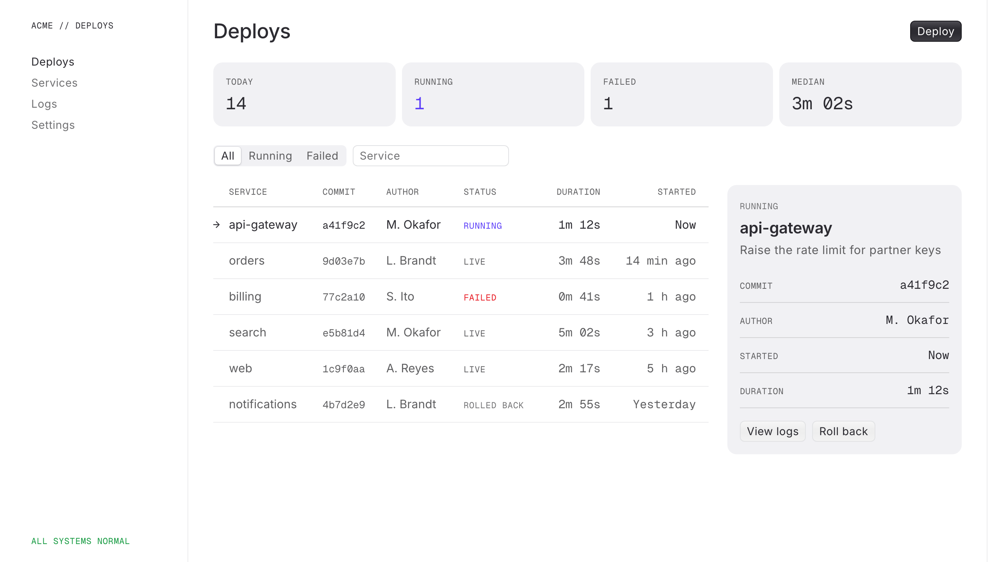

## Install

Claude Code, as a plugin:

```
/plugin marketplace add cnzn0/canzano-skill
/plugin install canzano@canzano
```

Any agent that reads skills (Claude Code, Codex and others), with one command:

```bash
curl -fsSL https://raw.githubusercontent.com/cnzn0/canzano-skill/main/install.sh | sh
```

It copies the skill into `~/.claude/skills`, `~/.agents/skills` and `~/.codex/skills`, whichever exist. To choose the folder yourself:

```bash
git clone --depth 1 https://github.com/cnzn0/canzano-skill && sh canzano-skill/install.sh ~/.claude/skills
```

With the skills CLI:

```bash
npx skills add cnzn0/canzano-skill
```

Or paste this into your agent:

```
Install the canzano skill. Clone https://github.com/cnzn0/canzano-skill, copy its
plugin/skills/canzano folder into my skills folder (~/.claude/skills for Claude Code,
~/.agents/skills or ~/.codex/skills for Codex), then read its SKILL.md
and confirm it is installed.
```

claude.ai: download `canzano.zip` from the [latest release](https://github.com/cnzn0/canzano-skill/releases/latest) and upload it under Settings, Capabilities, Skills.

To make it the default for every output, add one line to your `CLAUDE.md` or `AGENTS.md`:

```
Read the canzano skill before writing any page, report, doc, PDF, deck, chart, diagram or UI.
```

## What it does

Ask as you normally would. The skill changes how the answer looks and reads.

| Ask | Outcome |
|---|---|
| "Compare our three hosting options, one-pager as a PDF" | [report.pdf](examples/report.pdf) |
| "Draw how a checkout request moves through our services" | [diagram.html](examples/diagram.html) |
| "Animate how a write gets replicated" | [animated-diagram.html](examples/animated-diagram.html) |
| "Quick internal tool to review today's deploys" | [web-ui.html](examples/web-ui.html) |
| "A phone screen for this week's runs" | [mobile-ui.html](examples/mobile-ui.html) |
| "A settings page with an invite form" | [settings.html](examples/settings.html) |
| "Turn the checkout review into slides" | [deck.html](examples/deck.html), [deck.pdf](examples/deck.pdf) |
| "Chart this" | [viz.html](examples/viz.html): every chart and diagram type |
| "A README diagram of the checkout path" | [ascii.html](examples/ascii.html) |

Each outcome is one self-contained HTML file. Figures and names in them are made up.

### UI

Small rounded controls, flat panels, a sidebar frame. Every control shares one height, radius and edge, so any mix lines up.

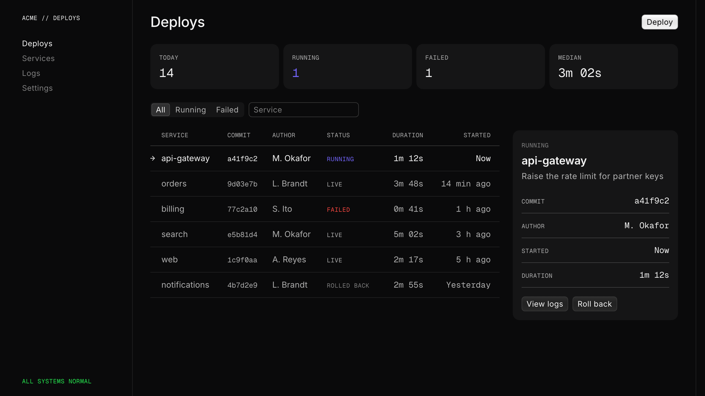

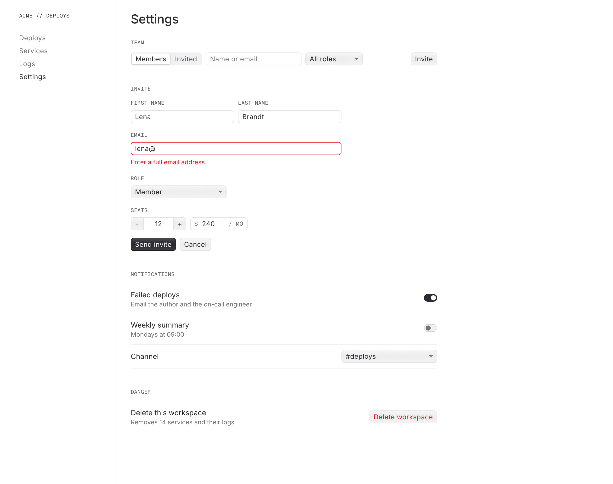

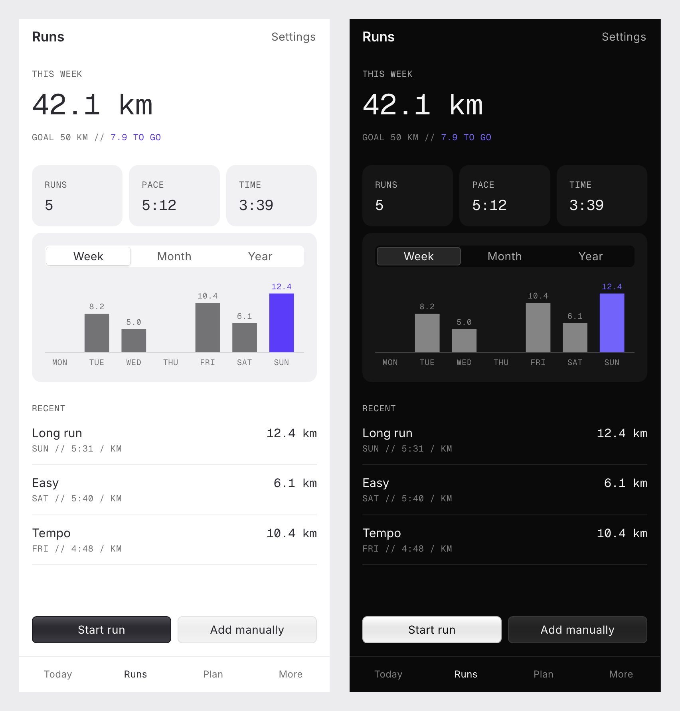

### Controls and forms

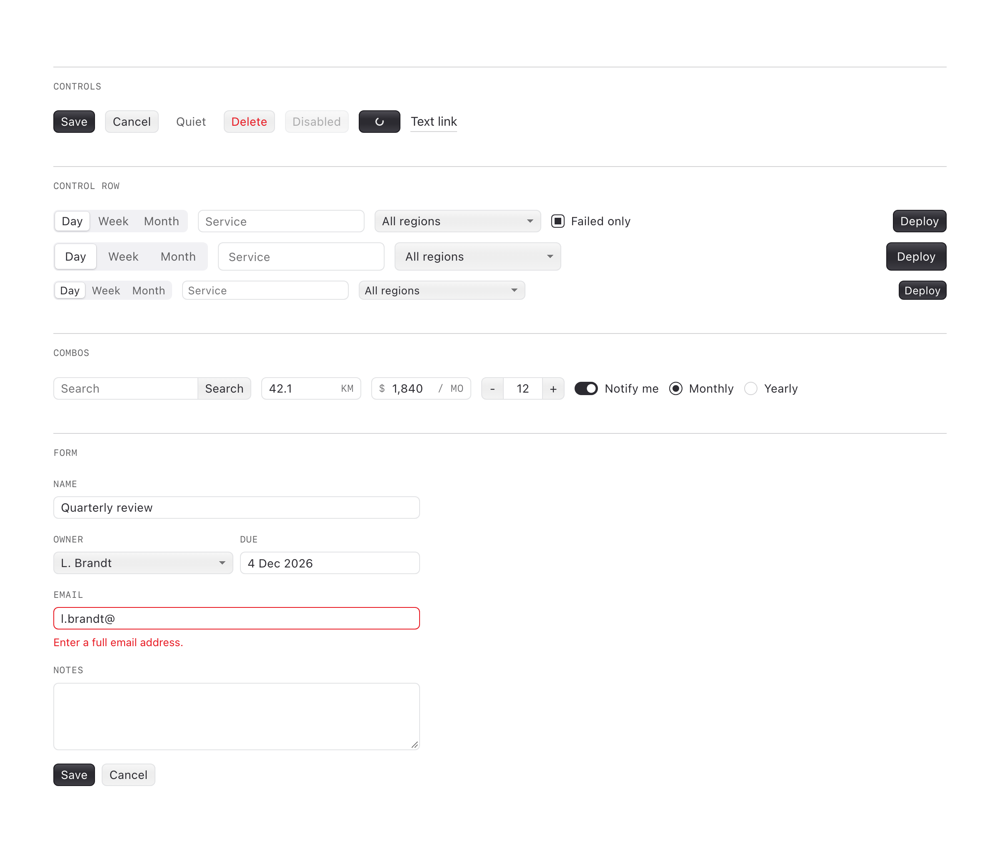

### Colour

Eleven vivid hue scales and a grey scale, all OKLCH, behind a small set of semantic tokens. Colour is rare and saturated.

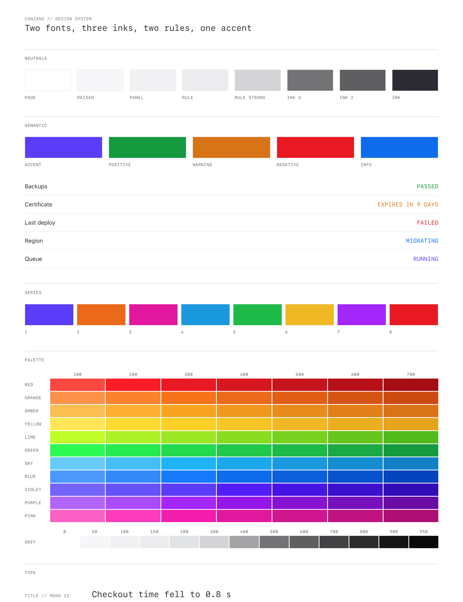

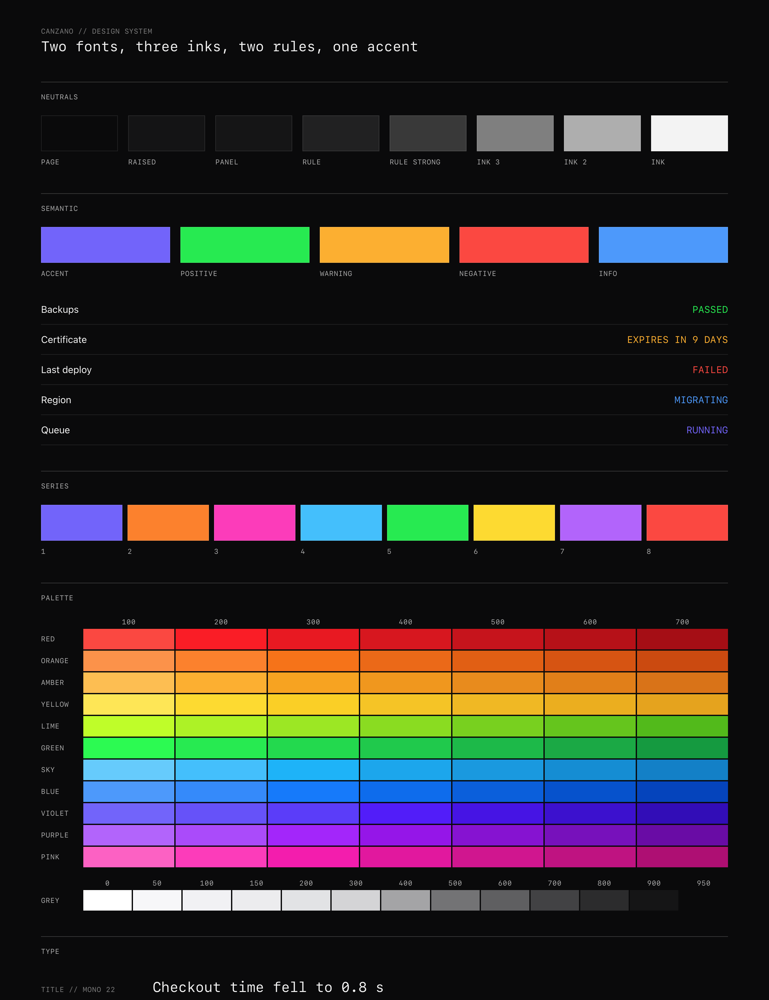

### Documents and PDFs

The answer first, hairline tables, mono figures. The PDF is the same page, printed.


### Decks

1280 x 720 slides from one HTML file: a claim in every headline, evidence that fills the slide, one slide per PDF page.

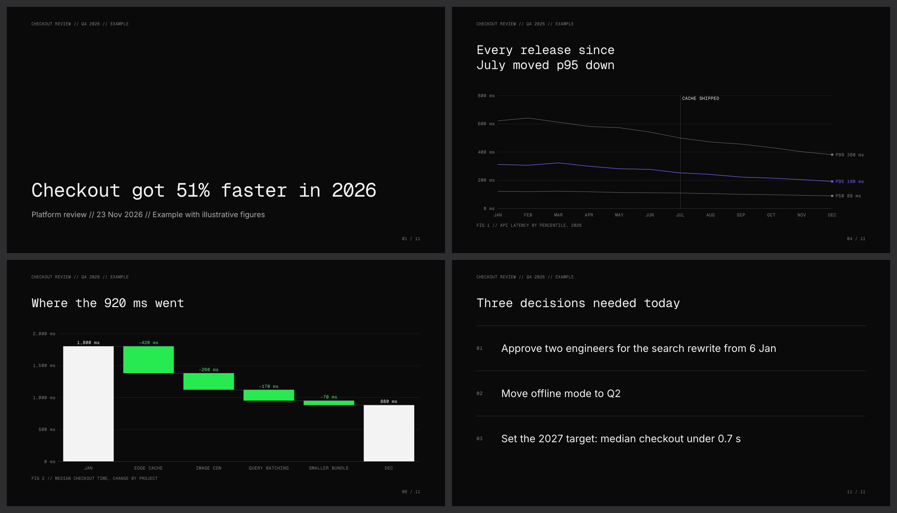

### Charts

Eight chart types from a JSON spec, drawn by one dependency-free script. Grey for context, the accent for the point.

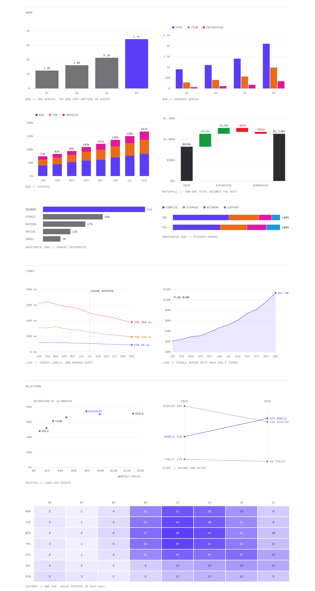

### Diagrams

Flow, sequence, layers, tree, timeline and quadrant from a spec. Orthogonal, one stroke width, all caps mono. Animated diagrams move one mark along the real connectors.

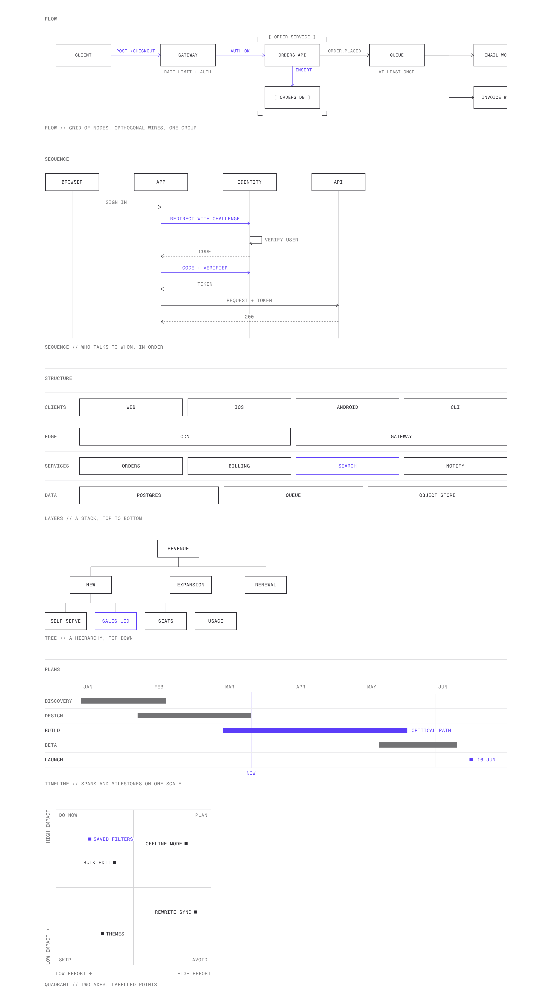

### ASCII

Aligned diagrams, tables, bars and hero text for READMEs, terminals and code comments.

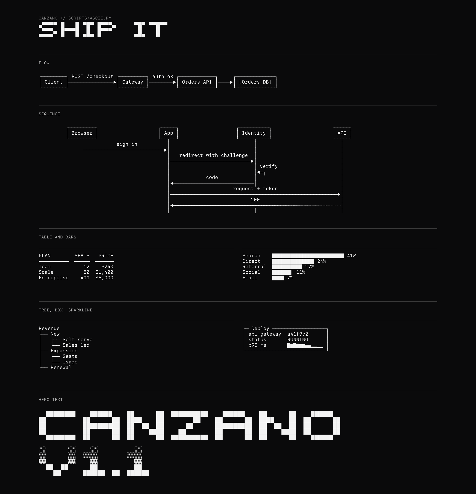

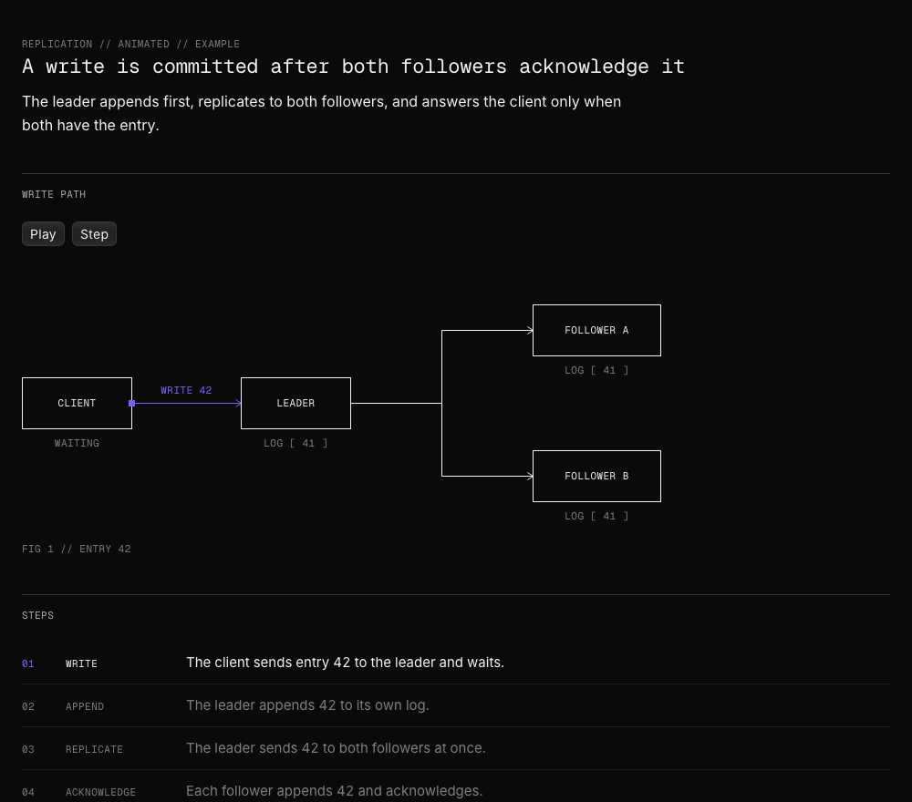

## What is in it

```
plugin/skills/canzano/
  SKILL.md                 the rules, the token table, the ban list
  assets/palette.css       11 hue scales and a grey scale, generated
  assets/tokens.css        the semantic tokens pages use
  assets/base.css          type, tables, ledgers, controls, forms, print
  assets/ui.css            the extra layer for interfaces
  assets/viz.js            charts and diagrams from a JSON spec, plus a layout lint
  assets/deck.html         the starting point for a deck (deck.css, deck.js)
  assets/template.html     the starting point for any HTML output
  assets/specimen.html     the whole system on one page
  references/              ascii, charts, colour, controls and forms, decks, diagrams, PDFs, UIs, writing
  scripts/pdf.sh           prints a page to PDF with headless Chrome
  scripts/palette.py       regenerates the palette
  scripts/ascii.py         aligned ASCII diagrams, tables, bars and hero text
examples/                  the outcomes above; rebuild with build_examples.py
plugin/                    the Claude Code plugin: this skill plus its manifest and icon
```

## Make it yours

- **Accent.** Point `--accent` in `tokens.css` at another hue, such as `var(--pink-300)`.
- **Fonts.** Change `--sans` and `--mono` in `tokens.css` and the font link in `template.html`.
- **Hues.** Edit `HUES` in `scripts/palette.py` and run it.

## Notes

The interface structure (frame, small controls, flat panels) follows measurements of sfcompute.com. The fonts are Inter and Geist Mono, loaded from Google Fonts. MIT licence.
