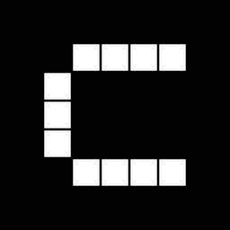
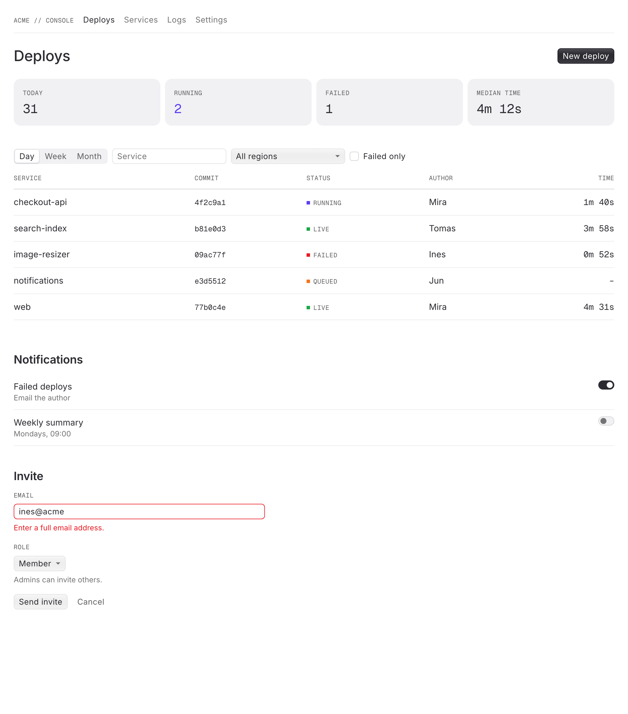
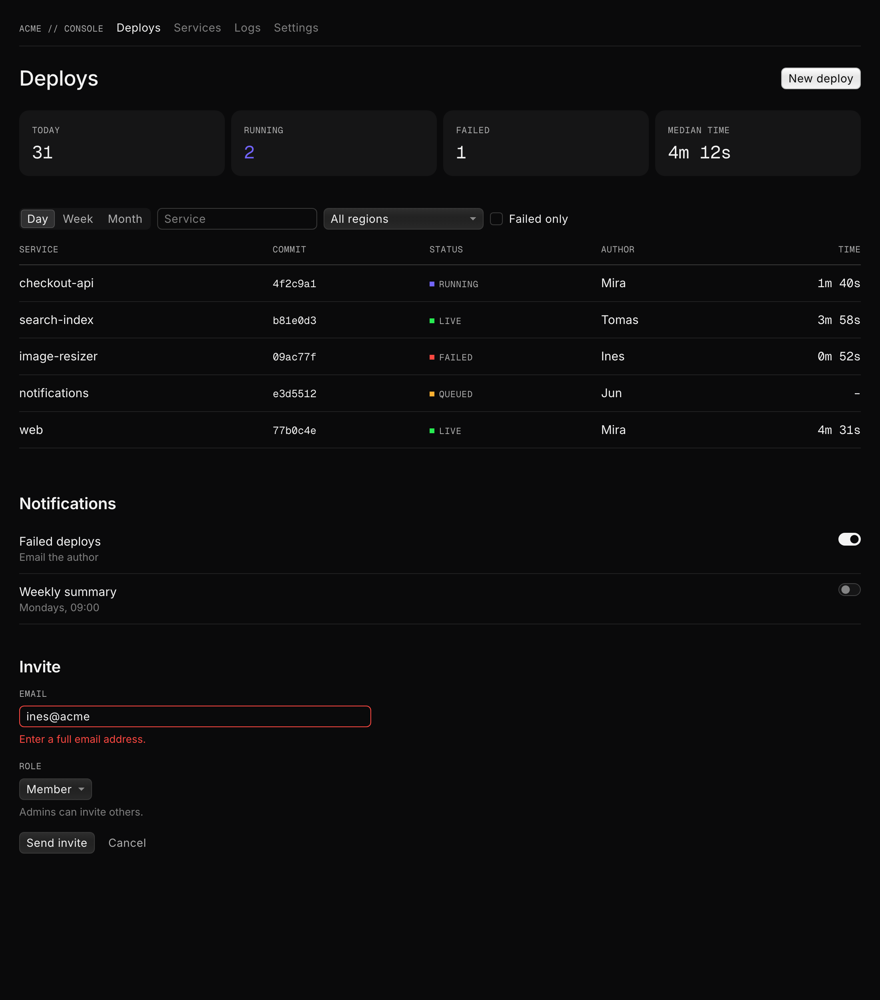
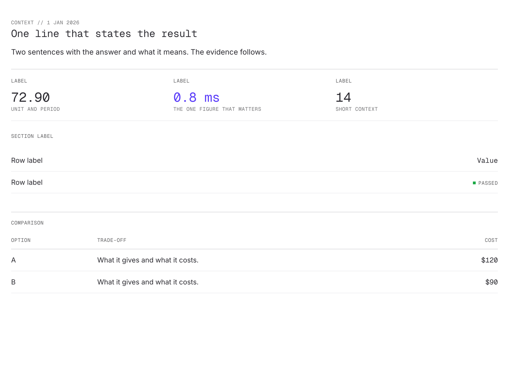
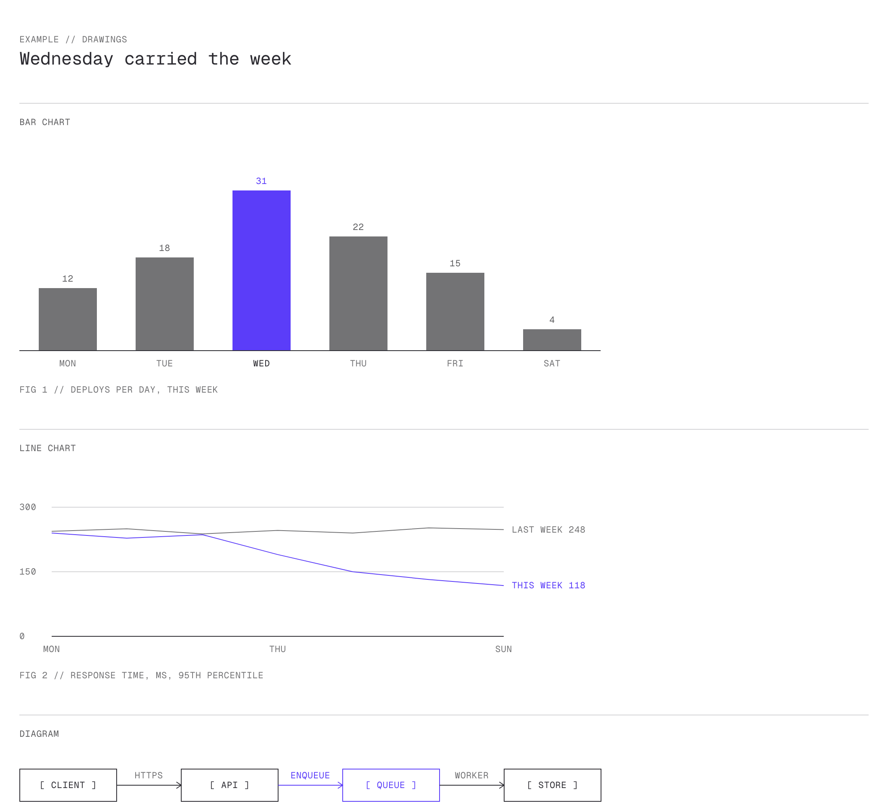
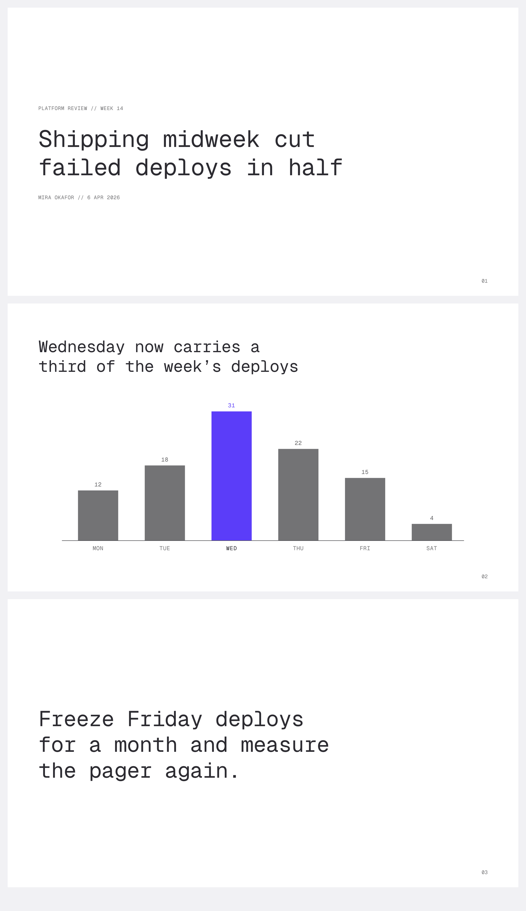

# canzano

A house style and minimal design system for AI agents. One small skill that makes pages, reports, PDFs, decks, charts, diagrams and UIs come out precise instead of generic: Inter and Geist Mono, OKLCH colour, hairline structure, small crisp controls, and rules against fluff in text and UI copy.



## Install

Claude Code, as a plugin:

```
/plugin marketplace add cnzn0/canzano-skill
/plugin install canzano@canzano
```

Any agent that reads skills (Claude Code, Codex and others), with one command:

```bash
curl -fsSL https://raw.githubusercontent.com/cnzn0/canzano-skill/main/install.sh | sh
```

It copies the skill into `~/.claude/skills`, `~/.agents/skills` and `~/.codex/skills`, whichever exist. To choose the folder yourself:

```bash
git clone --depth 1 https://github.com/cnzn0/canzano-skill && sh canzano-skill/install.sh ~/.claude/skills
```

With the skills CLI:

```bash
npx skills add cnzn0/canzano-skill
```

Or paste this into your agent:

```
Install the canzano skill. Clone https://github.com/cnzn0/canzano-skill, copy its
plugin/skills/canzano folder into my skills folder (~/.claude/skills for Claude Code,
~/.agents/skills or ~/.codex/skills for Codex), then read its SKILL.md
and confirm it is installed.
```

claude.ai: download `canzano.zip` from the [latest release](https://github.com/cnzn0/canzano-skill/releases/latest) and upload it under Settings, Capabilities, Skills.

To make it the default for every output, add one line to your `CLAUDE.md` or `AGENTS.md`:

```
Read the canzano skill before writing any page, report, doc, PDF, deck, chart, diagram or UI.
```

## What it does

Ask as you normally would. The skill changes how the answer looks and reads. It is rules, tokens and four examples: no chart library, no component framework, nothing to run.

### Interfaces

Small rounded controls, flat panels, one primary action. Every control shares one height, radius and edge, so any mix lines up.



### Documents and PDFs

The answer first, hairline tables, mono figures. The PDF is the same page, printed.



### Charts and diagrams

Hand-written SVG: grey for context, the accent for the point, one stroke width, all caps mono.



### Slides

A claim in every headline, one piece of evidence that fills the slide, one slide per PDF page.



## What is in it

```
plugin/skills/canzano/
  SKILL.md                 the rules, the token table, the never-ship list
  assets/
    palette.css            11 vivid hue scales and a grey scale, OKLCH
    tokens.css             the semantic tokens pages use, light and dark
    base.css               the whole stylesheet: type, tables, controls, panels, print
    template.html          the starting point for a page, report or PDF
  examples/                ui.html, chart.html, slides.html: to copy from
  references/              writing, colour, interfaces, figures, print
  scripts/pdf.sh           print a page to PDF
```

## Make it yours

- **Accent.** Point `--accent` in `tokens.css` at another hue, such as `var(--pink-300)`.
- **Fonts.** Change `--sans` and `--mono` in `tokens.css` and the font link in `template.html`.
- **Hues.** Edit `HUES` in `tools/palette.py` in this repository and run it.

## Notes

The control and panel recipe follows measurements of sfcompute.com. The fonts are Inter and Geist Mono, loaded from Google Fonts. MIT licence.

## Development

```bash
python3 tests/check.py
```

It checks that everything the guides name exists, renders the template and the examples at phone and desktop width in both themes, and prints the report and the slides.
